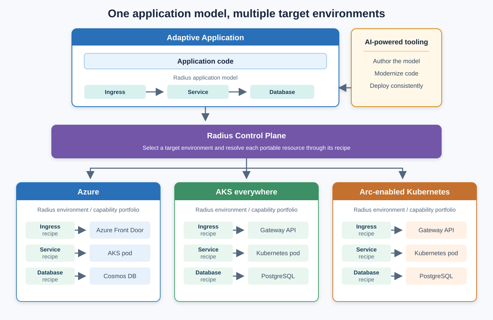

# Adaptive Apps

*Build once, Adapt everywhere.*

Modern applications increasingly need to run across public clouds, private infrastructure, sovereign environments, and resource-constrained edge locations. However, application code and deployment definitions are often tightly coupled to a specific platform's services, APIs, and operational tooling. Moving an application to a new environment can therefore require significant re-architecture, duplicated platform integration, and separate operational processes. These challenges are especially acute for organizations that must meet data residency and regulatory requirements, operate with limited or intermittent connectivity, or modernize existing applications without rewriting them.

Adaptive Apps address this problem by separating an application's intent and programming model from the environment-specific implementation of its required capabilities. Applications target explicit capability contracts rather than a particular infrastructure stack, allowing each environment to provide those capabilities using the technologies best suited to it. By combining a platform-agnostic application model, portable APIs, consistent capability portfolios, and AI-powered modernization tooling, Adaptive Apps enable applications to move across cloud, edge, and hybrid environments without re-architecture or unnecessary platform lock-in.

## Value Proposition

* **Enable sovereign, multi-cloud, and isolated edge deployments**

    Meet regulatory, geopolitical, and operational requirements while maintaining a single application model.

* **Unlock existing investments by modernizing brownfield applications**

    Extend the life and value of legacy systems by making them portable, adaptable, and future-ready.

* **Bridge AI-native agentic systems with traditional microservices**

    Create a unified platform where emerging AI-driven workflows and established enterprise services operate together seamlessly.

## Architecture

Adaptive Apps is comprised of four layers: application model, (optional) programming model, platform portfolios and AI-powered tooling. Rather than redefining these concepts from the ground up, Adaptive Apps leverage proven open-source and cloud-native technologies, such as [Radius](https://docs.radapp.io/), [Dapr](https://dapr.io/), and Azure Arc, and orchestrate them into an end-to-end solution.

    

    <em>Conceptual deployment flow based on the <a href="https://learn.microsoft.com/azure/architecture/solution-ideas/articles/adaptive-apps">Adaptive Apps solution in the Azure Architecture Center</a>.</em>

### **Platform-agnostic application model**

Adaptive Apps use [Radius](https://docs.radapp.io/) as the application model.

A Radius application is composed of multiple resources, where each resource type can be deployed to supported environments using environment-specific recipes. This provides a clean and extensible abstraction for describing platform-agnostic applications.

Radius resource types are extensible, allowing Adaptive Apps to introduce new concepts such as AI agents alongside existing core resource types like compute and storage.

### **Platform-agnostic programming model**

For an application to be truly portable, its code must avoid direct dependencies on platform-specific APIs.

[Dapr](https://dapr.io/) provides this abstraction through a sidecar model that exposes platform capabilities, such as state management, messaging, and pub/sub, behind stable, portable APIs. Adaptive Apps support Dapr as the preferred programming model for new applications. In addition, Adaptive Apps provide AI-powered refactoring tools to help uplift brownfield applications by incrementally introducing the Dapr programming model.

> **NOTE**: Using Dapr is not mandatory. When sufficient platform parity exists across target environments, applications may bind directly to platform-specific APIs. For example, if all required services are available across Azure and Azure Arc, an application written against Azure APIs can remain portable within that scope.

### AI-powered tooling

Adaptive Apps adopt and extend AI-enabled tools to simplify adoption and modernization.

As an initial capability, Adaptive Apps provide AI-based refactoring tools that assist in transforming legacy applications to adopt the Dapr programming model and portability patterns.

## Capability Portfolios

Delivering a consistent set of platform capabilities across cloud and edge environments is challenging due to differences in software availability, compatibility, and resource constraints.

To enable predictable portability, Adaptive Apps introduce the concept of a **capability portfolio**, which is a well-defined set of capabilities that an environment must provide in order to host a Adaptive App.

An application targets a specific capability portfolio and can be deployed to any environment that implements that portfolio.

A horiztonal comparison of portfolios is available [here](./docs/portfolios/overview.md).

### **Defined portfolios**

As a starting point, we define six portfolios with clear inheritance:

* [`min`](./docs/portfolios/min.md)

    Baseline capabilities for adaptive application hosting, including authentication, service hosting, and observability. Ideal for PoC, MVP, hackathon, demos and experiments. [read more...](./docs/portfolios/min.md)

* [`core`](./docs/portfolios/core.md)

    Builds on `min` and provides operational readiness, including service mesh, data sync, basic policy reinforcement, and secret management. Ideal for operating standard production workloads. [read more...](./docs/portfolios/core.md)

* [`ent`](./docs/portfolios/ent.md)

    Builds on `core` and represents the large-scale enterprise developments, including advanced policy reinforcement, optional sidecar enablement, advanced certificate management, advanced monitoring and backup/restore.

* [`min-ai`](./docs/portfolios/min-ai.md)

    Builds on `min` and adds local AI model management for continued offline AI inferences. [read more...](./docs/portfolios/min-ai.md)

* [`core-ai`](./docs/portfolios/core-ai.md)

    Builds on `core` and adds local AI model management for continued offline AI inferences. [read more...](./docs/portfolios/core-ai.md)

*  [`ent-ai`](./docs/portfolios/ent-ai.md)

    Builds on `ent` and adds local AI model management for continued offline AI inferences. [read more...](./docs/portfolios/ent-ai.md)   

### **Capability portfolio deployment**

Adaptive Apps don't assume a specific control plane that operates the applications. A capability vendor is free to choose the most appropriate packaging and delivery mechanism to bootstrap a portfolio, including:

* Helm charts for Kubernetes environments
* Azure Arc extensions
* Azure Bicep templates
* Terraform templates

As long as the portfolio satisfies the capability contract, applications remain portable.

### **Third-part capability vendors**

Adaptive Apps enable third-party vendors to implement and deliver capability portfolios on cloud, edge, or specialized environments. As long as a portfolio exposes the required capabilities and APIs, any Adaptive App targeting that portfolio can be deployed without modification.

To support the Radius application model, capability vendors are expected to implement the necessary Radius recipes for deployment.

## Getting Started

Follow our getting-started tutorials to deploy a Adaptive App across cloud and edge environments.
* [Min Portfolio - getting started](./tutorials/min-getting-started/README.md)
* [Min-AI Portfolio -getting started](./tutorials/min-ai-getting-started/README.md)
* [Core Portfolio - getting started](./tutorials/core-getting-started/README.md)
* [Core-AI Portfolio - getting started](./tutorials/core-ai-getting-started/README.md)
* [Ent Portfolio - getting started](./tutorials/ent-getting-started/README.md)
* [Ent-AI Portfolio - getting started](./tutorials/ent-ai-getting-started/README.md)

## Topics

* [Authentication](./docs/authentication/README.md)
* [Data Sync](./docs/data-sync/README.md)
* [Policies](./docs/policies/README.md)